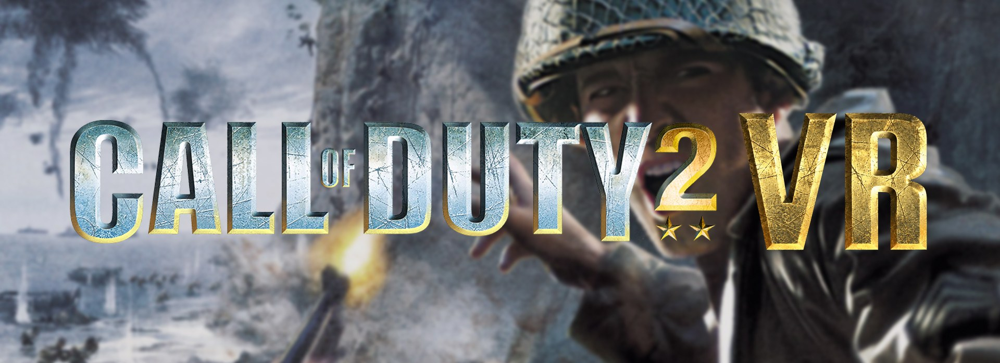

# CALL OF DUTY 2 VR

**English** | [Português](README.pt-BR.md)

A PC VR mod for the **Call of Duty 2 single player campaign** (`CoD2SP_s.exe` 1.3). Play the 2005 game in your
headset: you look around and move with your own body, the gun is in your hand, you aim with the controller and you see
the HUD and menus on a floating screen. From the makers of the
[Call of Duty 1 VR mod](https://github.com/lambda-gab/cod1-vr).

> **Disclaimer:** unofficial fan project, not affiliated with or endorsed by Activision. Call of Duty is a
> trademark of Activision Publishing, Inc. A legitimate copy of the game is required; no game code or game files
> are included or distributed (the optional packs are generated on your PC from your own copy).

> [!WARNING]
> **This project is in development.** Bugs and visual glitches can happen. Please report them on
> [Discord](https://discord.gg/SRsK2x5Tn).

## Support the developer

> [!TIP]
> **Would you like to help the dev? $2 keeps the Claude Pro plan running.**
>
> Every ported game is and always will be free for everyone. Your support pays for the AI plan and lets me spend a
> few hours of my day bringing joy to gamers.
>
> [**Support on Patreon**](https://www.patreon.com/cw/LambdaGab)

### Patreon supporters

<table>
  <tr>
    <td valign="middle"></td>
    <td valign="middle"><b>Dmitriy Melnikov</b> Master</td>
  </tr>
</table>

## Requirements

- Call of Duty 2 for PC, single player, **version 1.3** (`CoD2SP_s.exe`).
- A PC VR headset with controllers (tested with a Quest 3 through Virtual Desktop; Air Link and other PC VR
  headsets should work too).
- A **32-bit** OpenXR runtime: Virtual Desktop (VDXR), Oculus/Meta, or SteamVR (its 32-bit OpenXR runtime comes
  with the **SteamVR beta**: Steam > SteamVR > Properties > Betas). The game is a 32-bit program.

> [!NOTE]
> **Tested with the Quest 3.** If you have a problem with another headset, please
> [open an issue](https://github.com/lambda-gab/cod2-vr/issues) so I can look into it.

## Installation

> [!IMPORTANT]
> **VR does not start, or the game opens as two flat images side by side?** Save a **diagnostic report**
> (launcher > ABOUT > "Problem starting in VR?") and send it on [Discord](https://discord.gg/SRsK2x5Tn).

### Easiest: the installer (recommended)

1. Download `CoD2-VR-Setup.exe` from the [latest release](https://github.com/lambda-gab/cod2-vr/releases/latest).
2. Run it. It finds the game folder (or lets you pick it with **Change...**) and checks that the game is version 1.3.
3. Choose whether to create a desktop shortcut and press **INSTALL**.
4. Connect the headset and start the game with the **Call of Duty 2 VR** launcher (the shortcut, or
   `Call of Duty 2 VR.exe` in the game folder).

Run the installer again to update or uninstall. Your settings are kept on updates.

### Manual

1. Extract `cod2-vr-manual-install.zip` from the [latest release](https://github.com/lambda-gab/cod2-vr/releases/latest).
2. Copy `d3d9.dll`, `openxr_loader.dll`, `cod2_vr.ini`, `supporters.ini` and `Call of Duty 2 VR.exe` to the game
   folder (where `CoD2SP_s.exe` is).
3. Connect the headset, start `Call of Duty 2 VR.exe` and press PLAY.

To uninstall, delete those five files (and `main\zz_cod2vr.iwd` / `main\zz_cod2vr_font.iwd` if the launcher made
them).

## Controls

The gun stays in your dominant hand (set it in the launcher, CONTROLS). Weapons and grenades are taken from your
body with either hand's grip:

| Put the hand here and press the grip | You take |
|---|---|
| Over the right shoulder (hand behind the head) | Weapon 1 |
| Over the left shoulder | Weapon 2 |
| Behind you, at the lower back | Frag grenade (let go of the grip to throw it, along your swing) |
| At the left hip | Smoke grenade (the same) |
| On the chest | Binoculars (up while the grip holds them) |

Every zone can be changed in the launcher (CONTROLS). Reaching a zone gives a light vibration.

| Control | Action |
|---|---|
| Gun hand's trigger | Fire. The shots leave the gun's muzzle along the barrel |
| Grip of either hand at something to use or pick up | Use it (a weapon on a table, a switch, explosives to plant) |
| Gun hand's grip elsewhere | Use / pick up where the gun points |
| Free hand's grip on the gun's handguard | Hold the gun with both hands (steadier, less recoil) |
| Free hand's trigger, with the hand on something to use | Use it |
| Swing the gun into an enemy | Melee: any part of the gun, muzzle or stock |
| Back of the free hand turned to your eyes | Objectives, like looking at a watch |
| Left stick | Move (where you look) |
| Right stick | Turn (45° snap); up / down changes stance |
| A / B | Jump / reload |
| X / Y | Grenade / next weapon. Hold Y and press A: switch weapon 1 and 2 |
| Left stick click | Recenter (stand up straight); hold: objectives |
| Right stick click | Go prone |
| Menu | Game menu |

- A gun in the left hand (left-handed setting) is mirrored.
- Crouch for real and the soldier crouches. Stand up straight and click the left stick to recenter.
- The trigger (or A) skips the campaign's movies and starts a mission as soon as it has loaded.
- The controllers vibrate when you fire, get hit and reach a holster.

In menus, point with the right hand: trigger clicks, B goes back, A confirms.

## Settings

### The launcher

The launcher has the settings most players want, saved as soon as you change them:

- **GRAPHICS:** headset resolution (with the size per eye), antialiasing (MSAA), texture filtering (anisotropic),
  texture quality, a modern text font, brightness, and post-processing (sharpening, colour style, bloom).
- **VR:** movement (continuous, or Blink / Shift jumps, beta), comfort vignette, camera shake, snap or smooth turning,
  roomscale, physical crouch, menus fixed or following the head, what of the HUD stays on screen, subtitle size,
  the soldier's arms (shown, beta, or hidden), crosshair style, colour and opacity, grenade trajectory, melee by
  swinging the gun, two-hand steadiness and recoil, objectives on the hand, and vibration strength for shots, hits
  and holsters.
- **CONTROLS:** what each body zone holds, each button's action and shortcut, the dominant hand, which stick moves
  you, with profiles.

Rows marked *Coming soon* are options of the Call of Duty 1 VR mod that are not in this mod yet.

With the Steam version of the game, PLAY starts it through Steam.

Its choices go to `%APPDATA%\CoD2-VR\settings.ini` and take precedence over `cod2_vr.ini`.

### cod2_vr.ini

Everything else is in `cod2_vr.ini`, in the game folder, with a comment on each setting. If the game is under
`Program Files`, open the editor (Notepad) as administrator to save it. The most used ones:

- `[Controllers]` `WeaponOffset*`: gun position in the hand; `MuzzleDistance`: where the shots leave the gun;
  `FireFromGun`: shots from the muzzle (1) or from the eye (0).
- `[Controllers]` `Crosshair`, `CrosshairColor`, `CrosshairOpacity`, `CrosshairSize`, `SwingMelee`, `MeleeSpeed`.
- `[Holsters]`: what each body zone holds and the zones' heights.
- `[VR]` `RenderScale`, `RoomScale`, `WorldScale`, `FxAlways` (effects and decals drawn wherever the gun points).
- `[Comfort]`: the vignette, `ShakeKeep`, `WeaponCamera` (the reload animation moving the view), `SkipInvertMenu`.
- `[HUD]`: the floating screens, `HudMode`, `MenuFollowsHead`, the objectives on the hand.
- `[Buttons]`: each button's command (`+cmd` is held while pressed, `a|b` runs `a` on press and `b` on release).

The log is `cod2_vr.log` (under `Program Files` it lands in `%LOCALAPPDATA%\VirtualStore\...`).

## Releases

### v1.0.1

- **SteamVR no longer crashes the game at start** (Valve Index and other SteamVR headsets): the game gives each thread
  a very small stack and the SteamVR runtime ran out of it. The VR work now runs on a stack of its own.
- **The shots hit the crosshair**: the crosshair sits where the shots' line meets the world, at any distance, and
  with the gun held up to your eye the shots follow your eye's line along the gun.

### v1.0.0

The first release.

- Stereo rendering from each tracked eye, OpenXR (32-bit), head tracking with position, roomscale (optional).
- The gun in your dominant hand, aimed with the controller; the shots leave its muzzle along the barrel; a crosshair
  where they will hit (style, colour, opacity); two-handed hold.
- The soldier's arms follow your controllers (beta), or only the gun is shown; the gun is mirrored in the left hand.
- Weapons and grenades on your body: shoulders, lower back, left hip (smoke grenades), chest (binoculars), waist.
- Melee by swinging the gun; use and pick up with either hand; objectives on the back of your hand.
- Continuous movement or Blink / Shift jumps (beta), snap or smooth turning, physical crouch, ladders, head
  collision, comfort vignette, less camera shake, no view movement from the reload animation.
- HUD and menus on a floating screen, HUD modes, subtitle size, the supporters' panel beside the main menu.
- The training mission made for VR: no "aim down the sights" or "invert the mouse" prompts, the mannequin struck
  with the gun, the movies and briefings skipped with the trigger.
- Effects (smoke, fire) and decals no longer vanish when the gun points away.
- Launcher with GRAPHICS, VR, CONTROLS (profiles), MODS and ABOUT, a diagnostic report, and an installer.

## Building

Visual Studio with the C++ tools (x86), and the Khronos OpenXR loader in `deps/openxr/`
(`openxr_loader_windows-<version>.zip` from
[OpenXR-SDK-Source releases](https://github.com/KhronosGroup/OpenXR-SDK-Source/releases)).

- `proxy\build.bat` → `proxy\out\d3d9.dll`, `openxr_loader.dll`, `cod2_vr.ini`
- `launcher\build_launcher.bat` → `launcher\out\Call of Duty 2 VR.exe`
- `installer\build_setup.bat` → `installer\out\CoD2-VR-Setup.exe` (embeds the two above)

A version tag (`v1.0.0`) builds everything on GitHub Actions and publishes the release.

### Testing without a headset

`cod2_vr.ini`, `[Debug]` `FakeHeadset=1`: the whole headset path with made-up eyes, shown side by side on the monitor.

## Technical notes

How it was reverse engineered and how the stereo works: [docs/CoD2_VR_RE.md](docs/CoD2_VR_RE.md) (Portuguese).
`tools/` has the helpers used for it.
